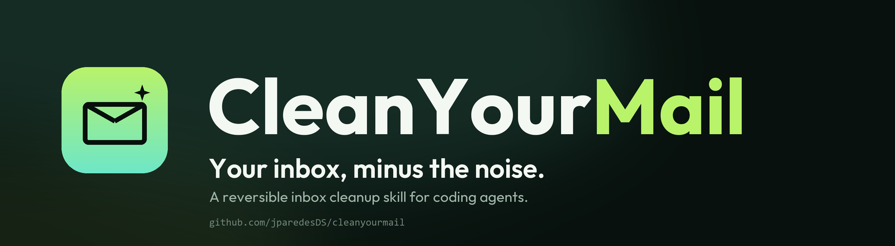
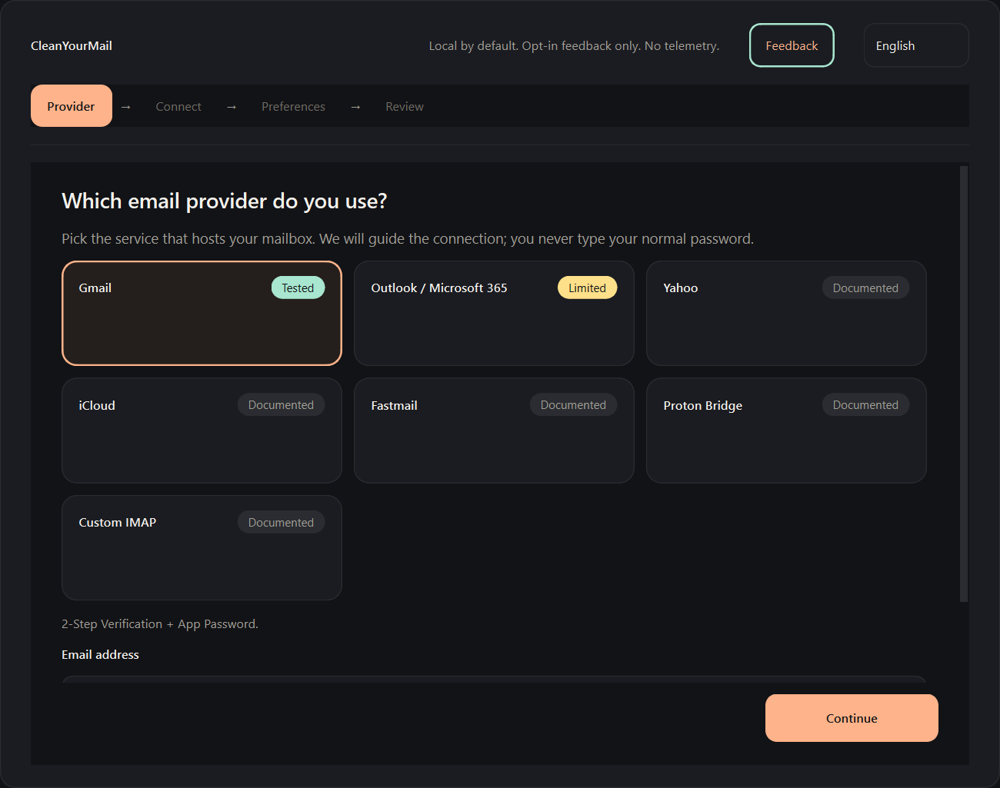
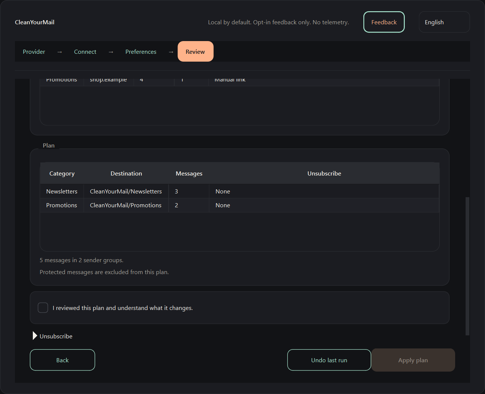

<p align="center">
  
</p>

<p align="center">
  <a href="https://github.com/jparedesDS/cleanyourmail-app/actions/workflows/tests.yml"></a>
  
  
  
  
</p>

<p align="center">
  <a href="README.md">English</a> ·
  <b>Español</b> ·
  <a href="README.pt-BR.md">Português (BR)</a> ·
  <a href="README.fr.md">Français</a> ·
  <a href="README.de.md">Deutsch</a> ·
  <a href="README.it.md">Italiano</a> ·
  <a href="README.ja.md">日本語</a> ·
  <a href="README.zh-CN.md">简体中文</a> ·
  <a href="README.zh-TW.md">繁體中文</a> ·
  <a href="README.ko.md">한국어</a>
</p>

# App de CleanYourMail

**Tu bandeja de entrada, sin el ruido — como app nativa para Windows.** CleanYourMail app es una
interfaz PySide6 para la CLI de [CleanYourMail](https://github.com/jparedesDS/cleanyourmail). Te
guía para conectar un buzón, elegir qué limpiar, revisar un plan reversible y deshacerlo.

Sin navegador, sin servidor local, sin cuenta, sin telemetría, sin cuerpos de mensaje y sin borrado
permanente. La única petición de red que hace la app por sí misma es el POST de feedback que envías
tú explícitamente.

> **Estado:** `0.5.0` es la versión early-MVP actual para Windows. Añade feedback opcional desde la
> cabecera de la app y la web. El instalador incluye el sidecar congelado de la CLI de CleanYourMail
> `1.3.0`. Gmail está validado; Outlook depende del modelo de consentimiento de Microsoft. Consulta
> el [estado de los proveedores](#provider-status).

## Descarga

[CleanYourMail app 0.5.0 para Windows 10/11 x64](https://github.com/jparedesDS/cleanyourmail-app/releases/latest)
es un instalador por usuario que incluye el sidecar fijado de la CLI de CleanYourMail `1.3.0` y no
necesita permisos de administrador.

El instalador 0.5.0 no tiene firma de código. Es posible que Windows SmartScreen muestre un aviso
de «Editor desconocido» al iniciarlo por primera vez: elige **Más información** y luego **Ejecutar de
todas formas**, y compara el SHA-256 publicado en la versión con el de `CleanYourMail-Setup-0.5.0.exe`:

```powershell
Get-FileHash .\CleanYourMail-Setup-0.5.0.exe -Algorithm SHA256
```

La versión también publica un archivo `.sha256` con el formato `HASH  filename`.

Gmail funciona con una contraseña de aplicación y la verificación en dos pasos. Outlook / Microsoft
365 no funciona con un solo clic: Microsoft 365 necesita el consentimiento del administrador del
inquilino, y las cuentas personales de Outlook.com necesitan un editor verificado. macOS y Linux
quedan fuera del alcance de 0.5.0.

## Por qué esta app

La CLI de CleanYourMail es el motor y la fuente de la verdad. Ya se encarga del acceso IMAP, la
clasificación, los planes, los movimientos reversibles y el diario de deshacer. Lo que no ofrece es
un camino corto para quien no quiere usar una terminal ni editar un archivo TOML.

Esta app añade ese camino sin duplicar el motor:

- Elige un proveedor y conéctate sin escribir una configuración a mano.
- Elige categorías y modo con casillas y botones de opción.
- Escanea, lee el informe e inspecciona el plan antes de que cambie nada.
- Aplica solo tras una revisión explícita y deshace desde la misma ventana.
- Lee todas las pantallas en inglés o español.

La app nunca implementa por su cuenta IMAP, la planificación, los movimientos, el deshacer ni la
cancelación de suscripciones. Llama al sidecar congelado de la CLI de CleanYourMail y muestra el
resultado, así que hay un solo modelo de seguridad y un solo conjunto de reglas.

## Capturas de pantalla

<p align="center">
  
  
</p>

<p align="center"><em>Datos de demostración sintéticos. Elige un proveedor y revisa el plan antes de aplicar nada.</em></p>

## Requisitos

- Windows 10/11 x64 para el instalador.
- Python **3.12+** solo para ejecutar desde el código fuente.
- El sidecar de la CLI de CleanYourMail `1.3.0`. El instalador lo incluye; para desarrollo, apunta
  `CYM_CLI` a un `cym-cli.exe` compilado con el mismo contrato JSON. La app no ejecuta `mail.py`
  directamente.

## Desarrollo

```bash
python -m venv .venv
.venv\Scripts\activate
python -m pip install -e ".[dev]"
python -m cleanyourmail_app --version
```

`python -m cleanyourmail_app --version` imprime `CleanYourMail app 0.5.0`.

Ejecuta las pruebas:

```bash
python -m pytest -q
```

La suite usa fixtures de una CLI falsa. Nunca necesita un buzón real, credenciales ni acceso a la
red.

## Qué hace la app

1. **Bienvenida / proveedor.** Gmail, Outlook / Microsoft 365, Yahoo, iCloud, Fastmail, Proton Bridge
   o IMAP personalizado, además de la dirección de correo.
2. **Conectar.** Un flujo guiado de contraseña de aplicación para Gmail, un flujo de código de
   dispositivo para Outlook y ayuda con la contraseña de aplicación de cada proveedor para el resto.
   Nunca se pide la contraseña normal.
3. **Preferencias.** Categorías que limpiar, carpetas o archivado, protecciones, límites e idioma.
4. **Revisar y limpiar.** Escaneo, informe, plan, paso de revisión, aplicación con un límite y el
   diario de deshacer. La columna de cancelación de suscripción del plan es solo informativa: esta
   compilación nunca envía solicitudes de cancelación y Aplicar siempre se ejecuta con
   `--action move`.

## Feedback

El feedback es **opcional y manual**. Ábrelo con el botón **Feedback** de la cabecera de la app o usa
el [formulario de la web](https://cleanyourmail.org/#feedback). No se recoge
nada en segundo plano y la app no envía nada hasta que pulsas **Enviar** y aceptas la línea de
consentimiento.

- La app rellena un **checklist editable** con las versiones de la app y del sidecar, la versión de
  Windows, el nombre del proveedor, el modo carpeta/archivado, las categorías seleccionadas y el
  idioma.
- Edita o borra todo lo que no quieras compartir. **No** incluyas contraseñas, tokens, direcciones
  de correo, asuntos, IDs de mensaje ni rutas de archivo en el mensaje ni en el checklist.
- El campo de contacto opcional es el único sitio para dejar un usuario de Discord, un nombre de
  usuario de GitHub o una dirección de correo. Nunca es obligatorio.
- La petición va a un Worker de Cloudflare (`cleanyourmail-feedback`), que la valida y la reenvía a
  un canal privado de Discord. El webhook de Discord es un secreto de Cloudflare y nunca se
  distribuye con la app ni con la web.
- **No hay cuenta, ni telemetría, ni analíticas, ni informes de fallos.** El Worker no almacena el
  cuerpo del mensaje y aplica un límite de frecuencia a corto plazo basado en la IP con sal.

<a id="provider-status"></a>

## Estado de los proveedores

| Proveedor | Ruta en la app | Estado |
|---|---|---|
| Gmail | Contraseña de aplicación + 2FA | correcto, validado con la CLI 1.3.0 |
| Outlook / Microsoft 365 | Código de dispositivo | parcial: Microsoft 365 necesita consentimiento del administrador del inquilino; Outlook.com personal necesita un editor verificado |
| Yahoo, iCloud, Fastmail | Contraseña de aplicación | documentado, sin smoke test |
| Proton Bridge | Contraseña de Bridge | documentado, sin smoke test |
| IMAP personalizado | Servidor; puerto fijo 993 con TLS | documentado, sin smoke test |

La app informa de estos estados con honestidad. No afirma que Outlook funcione con un solo clic.

## Modelo de seguridad

- **Solo local, salvo el feedback opcional.** Sin cuenta, nube, telemetría ni acceso al cuerpo de los
  mensajes. La app no hace ninguna petición de red en segundo plano; la única que hace por sí misma
  es el POST de feedback después de que pulses Enviar y aceptes la línea de consentimiento.
- **Solo la CLI.** La app no puede añadir capacidades que la CLI no tenga.
- **Ningún secreto en argv.** Las contraseñas de aplicación se escriben en el `password_file` de la
  CLI; la app nunca las pasa como argumentos de línea de comandos.
- **Ningún secreto en reposo en los ajustes de la app.** Los secretos nunca entran en QSettings, los
  registros, los diálogos de error ni la salida de las pruebas.
- **Revisar primero.** Ninguna escritura sin un plan revisado; deshacer queda a un clic.
- **Sin borrado permanente.** Los movimientos y el archivado son reversibles.
- **Sin cancelación de suscripción en 0.5.0.** El plan puede mostrar modos de cancelación, pero
  Aplicar solo mueve mensajes.
- **Inglés y español de primera clase.** Cada cadena vive en `i18n/*.json`.

Consulta [SECURITY.md](SECURITY.md) para saber cómo informar de una vulnerabilidad.

## Estructura del proyecto

| Ruta | Qué es |
|---|---|
| `src/cleanyourmail_app/` | Paquete de la app nativa. |
| `src/cleanyourmail_app/version.py` | Única fuente de la versión de la app. |
| `src/cleanyourmail_app/__main__.py` | Punto de entrada de `python -m cleanyourmail_app`. |
| `src/cleanyourmail_app/app.py` | Construye los servicios locales y abre el asistente. |
| `src/cleanyourmail_app/ui/` | Ventana, páginas, widgets, tema y recursos de PySide6. |
| `src/cleanyourmail_app/domain/` | Catálogo de proveedores, ajustes, preferencias y modelos de plan. |
| `src/cleanyourmail_app/services/` | Cliente del sidecar (`cli.py`), configuración (`config.py`), secretos (`secrets.py`), OAuth (`oauth.py`) y ajustes (`settings.py`). |
| `src/cleanyourmail_app/i18n/` | Cadenas en inglés y español. |
| `scripts/` | Compilaciones del sidecar y de la app, y el smoke test del instalador. |
| `packaging/` | Script de Inno Setup e iconos. |
| `tests/` | Suite de pytest y pytest-qt con fixtures de CLI falsa. |
| `docs/superpowers/specs/` | Documentos de diseño (app 0.3.0, feedback 0.4.0). |
| `docs/superpowers/plans/` | Plan de implementación tarea a tarea. |

## Enlaces

- Versiones publicadas de la app: <https://github.com/jparedesDS/cleanyourmail-app/releases/latest>
- Skill y CLI: <https://github.com/jparedesDS/cleanyourmail>
- Web: <https://cleanyourmail.org/>
- Modelo de seguridad: <https://github.com/jparedesDS/cleanyourmail/blob/master/docs/SAFETY.md>

## Licencia

MIT. Ver [LICENSE](LICENSE).
