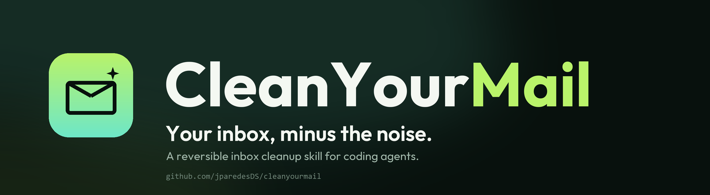
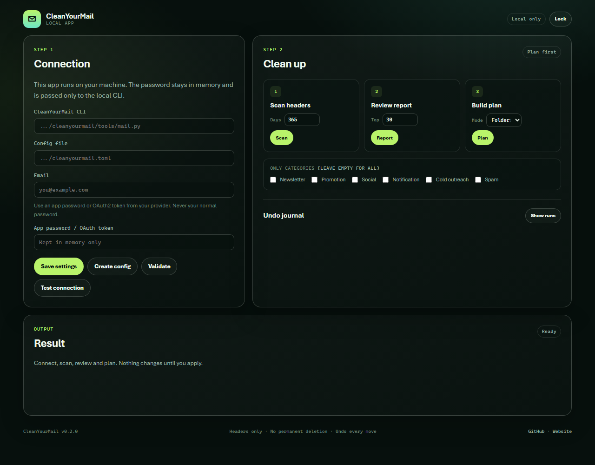

<p align="center">
  
</p>

<p align="center">
  <a href="https://github.com/jparedesDS/cleanyourmail-app/actions/workflows/tests.yml"></a>
  
  
  
</p>

# CleanYourMail — local app

**Your inbox, minus the noise — with a UI.** A local, secure app for people who prefer buttons over
prompts. It wraps the existing [CleanYourMail](https://github.com/jparedesDS/cleanyourmail) CLI:
scan headers, review a plan, apply reversible moves, unsubscribe separately and undo.

No cloud, no account, no telemetry, no bodies, no permanent deletion.

> **Status:** `0.1.0` MVP. Local only, from source. The CLI remains the source of truth.



## Why this app

CleanYourMail is a skill for coding agents. The CLI is deliberately small, but it still expects a
terminal and a config file. This app is a front door for people who do not want to learn prompts or
edit TOML:

- Choose a config file and create it from your provider and email.
- Test the connection.
- Scan, report, plan, review and apply from one screen.
- See the exact moves and unsubscribe targets before anything changes.
- Keep the undo journal one click away.

The app does not reimplement IMAP, classification or safety rules. It calls the CLI and shows the
result. That keeps one safety model, one test suite and one source of truth.

## Requirements

- Python **3.11+**.
- The [CleanYourMail CLI](https://github.com/jparedesDS/cleanyourmail) repository.
- No `pip install`: the app and the CLI use the Python standard library.

## Quick start

Clone both repositories side by side:

```bash
git clone https://github.com/jparedesDS/cleanyourmail.git
git clone https://github.com/jparedesDS/cleanyourmail-app.git
cd cleanyourmail-app
python app.py
```

The app starts a local server on `127.0.0.1` with a random port and prints a **one-time URL**. It
opens your browser. If the browser does not open, copy the URL from the terminal.

The app auto-detects `../cleanyourmail/tools/mail.py`. If your folder has another name, set the CLI
path in the app.

### First run

1. Set the **config file** path (or keep the default).
2. Enter your email and click **Create config**. The CLI picks the provider preset from the domain.
3. Put your app password or OAuth2 token in the password field. It stays in memory.
4. Click **Test connection**.
5. Scan, review the report and build a plan.
6. Review the plan, check the box and apply the moves.
7. Unsubscribe separately, only if you want to. It is irreversible.
8. Use the undo journal for moves and Gmail archives.

The app never writes the password to disk or logs. If you prefer, set `CYM_PASSWORD` in the
environment before starting the app; the password field is then optional.

## What you can do

| Action | CLI command | Changes mail? |
|---|---|---|
| Validate config | `validate` | No |
| Test connection | `doctor` | No |
| Scan headers | `scan` | No |
| Review report | `report` | No |
| Build plan | `plan` | No |
| Apply moves | `apply --action move` | Moves/archives |
| Unsubscribe | `unsubscribe` | Sends requests |
| Undo | `undo` | Moves/archives |

Unsubscribe is separate on purpose. The app will not mix it with the move step.

## Security model

- **Localhost only.** The server binds `127.0.0.1`; there is no option to expose it.
- **One-time URL + session.** The startup token is single-use. The browser gets an `HttpOnly`,
  `SameSite=Strict` session cookie.
- **CSRF and Origin checks.** Every API call needs the session, a CSRF header and a localhost Origin.
- **Strict CSP.** No inline scripts, no external assets, no third-party requests.
- **No secret storage.** The password lives in the page memory and is passed to the CLI subprocess
  through its environment. It is never written to disk or logs.
- **No bodies, no permanent deletion.** The app cannot add capabilities the CLI does not have.
- **Review first.** Applying moves requires an explicit reviewed-plan flag; unsubscribe has its own
  confirmation and cap. A plan can be applied once; build a new plan for another run.
- **Safe rendering.** Email subjects and senders are treated as text, never HTML.

Read [docs/THREAT_MODEL.md](docs/THREAT_MODEL.md) for the full model.

## How it works

```text
Browser (127.0.0.1)
        |
        v
app.py / local HTTP server  --->  cleanyourmail/tools/mail.py  --->  IMAP / SMTP
        |                                  |
        +---- static UI (no build step)    +---- plan.json / journal / config
```

The server keeps only non-secret paths in a small settings file. The CLI owns the config, the state
cache, the plan and the undo journal. See [docs/ARCHITECTURE.md](docs/ARCHITECTURE.md).

## Tests

```bash
python -m unittest discover -s tests -v
python -m compileall -q app.py cleanyourmail_app tests
```

The suite covers the session store, CLI wrapper, one-time token, CSRF/Origin checks, security
headers, static path traversal and session lock. The CLI tests use a fake `mail.py`, so no real
mailbox is needed.

## Project layout

| Path | What it is |
|---|---|
| `app.py` | Entry point. |
| `cleanyourmail_app/server.py` | Local HTTP server and API routes. |
| `cleanyourmail_app/cli.py` | Locates and calls the CleanYourMail CLI. |
| `cleanyourmail_app/security.py` | One-time tokens, sessions, CSRF. |
| `cleanyourmail_app/settings.py` | Non-secret path settings. |
| `static/` | HTML, CSS and JavaScript. No build step. |
| `docs/` | Banner, architecture and threat model. |
| `tests/` | Standard-library unittest suite. |

## Limitations

- This is a source-run MVP, not a signed desktop binary yet.
- Long scans show a busy state; progress streaming comes later.
- The app does not acquire or refresh OAuth tokens; the CLI does not either.
- The app is not a hosted service and should not be exposed on a network.
- Gmail labels, provider limits and tenant policy still apply exactly as in the CLI.

## Links

- Skill and CLI: <https://github.com/jparedesDS/cleanyourmail>
- Website: <https://jparedesds.github.io/cleanyourmail-web/>
- Safety model: <https://github.com/jparedesDS/cleanyourmail/blob/master/docs/SAFETY.md>
- App security: [SECURITY.md](SECURITY.md)

## License

MIT. See [LICENSE](LICENSE).
